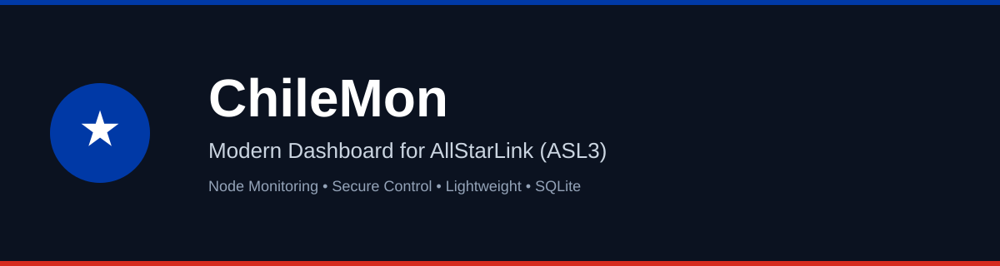
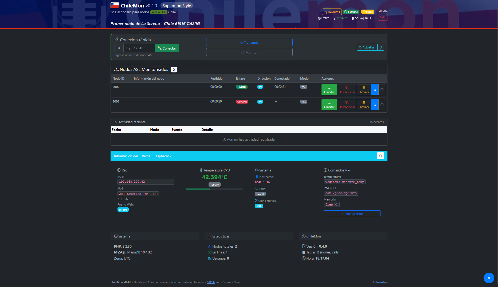
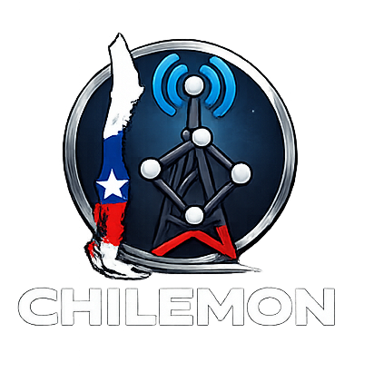
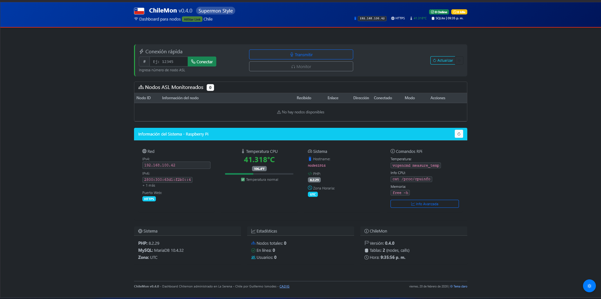
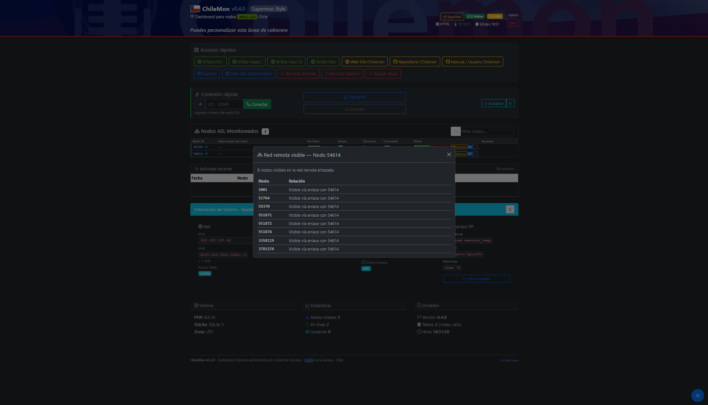
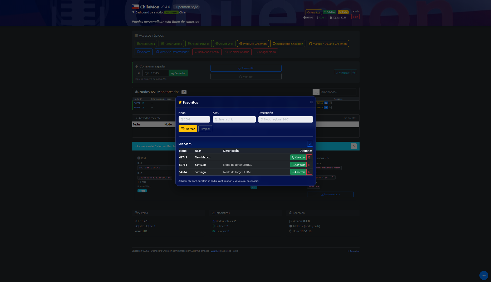

<p align="center">
  
</p>

<p align="center">

</p>

##

<p align="center">
Modern dashboard for monitoring and controlling AllStarLink nodes
</p>

<p align="center">


</p>

#
# 
<p align="center">
  
</p>

A modern dashboard for monitoring and controlling **AllStarLink (ASL3)** nodes. ChileMon was created as a modern alternative inspired by **Supermon**, designed to provide a clearer, more modular, and easier-to-install interface for AllStar node operators.

The goal of the project is to provide a simple and secure tool to view and control the activity of an AllStarLink node from a web browser.

## 🌐 Languages

🇪🇸 Spanish documentation: `README_ES.md`  
🇬🇧 English documentation: `README.md`

---

# 📡 What is ChileMon?

ChileMon is a web application that allows you to:

- monitor connected nodes
- connect remote nodes
- disconnect nodes
- visualize the linked node network
- review node statistics
- manage favorite nodes
- view recent activity

All from a modern web interface.

---

# ✨ Main Features

ChileMon currently includes:

- Web dashboard for AllStarLink node monitoring
- Remote node connection and disconnection
- Real-time visualization of connected nodes
- Node statistics obtained from Asterisk
- Modal window to visualize the linked node network
- Favorite node management
- Recent activity logging
- Secure command execution through a wrapper
- Automatic installer for ASL3 systems
- **User authentication system with roles** (admin/user)
- **Admin panel** for user management and system information
- **Health check endpoint** (`/api/health.php`)
- **Rate limiting** on all API endpoints
- **Node whitelist** for connect/disconnect control
- **CSRF protection** on all forms
- **WebRTC Audio Bridge** — Browser-based Push-to-Talk (PTT) from the dashboard
- **Bridge IAX2 Direction Reversal** — Robust IAX2 server mode for ASL3 compatibility
- **🗺️ Installation Map** — Opt-in community map showing all ChileMon nodes (Leaflet + OpenStreetMap)
- **Interactive Map Picker** — Click-to-set coordinates in registration modal with draggable marker
- **Address Geocoding** — Type an address and the map auto-positions via Nominatim (OpenStreetMap)
- **Cross-Origin Registration** — Agent nodes register on the hub without pre-existing session

---

# 🧠 Project Philosophy

ChileMon was designed with the following principles:

- **Do not interfere with AllStarLink**
- **Do not modify Asterisk**
- **Do not replace Supermon**
- **Be a modular tool**
- **Be easy to install**
- **Be secure**

ChileMon works as an **additional module**, without altering the node’s base installation.

---

# 🏗 Architecture

ChileMon is built using simple and robust technologies.

### Backend

- PHP 8+
- SQLite

### Frontend

- Bootstrap 5
- JavaScript
- AJAX

### Server

- Apache

### WebRTC Bridge

- Python 3.11+ (aiortc + aiohttp + websockets)
- WebSocket for real-time audio
- IAX2 protocol for Asterisk integration

---

# 🔐 Security

ChileMon **does not execute Asterisk commands directly from PHP**.

Instead, it uses a secure wrapper:

```
/usr/local/bin/chilemon-rpt
```

This wrapper allows only specific commands to be executed:

 - rpt nodes
 - rpt stats
 - rpt connect
 - rpt disconnect

The commands are executed through a restricted sudo rule for the user:

```
www-data
```

This prevents arbitrary command execution on the system.

### Additional security features

- **User roles**: Admin and regular user roles. Admin panel (`/admin.php`) restricted to admin users
- **Rate limiting**: Reusable middleware limits API endpoints to prevent abuse (configurable per endpoint)
- **CSRF Protection**: Every form includes a per-session CSRF token validated with timing-safe comparison
- **Session hardening**: Strict mode, HTTP-only cookies, SameSite=Lax, inactivity timeout
- **Node whitelist**: Restrict which nodes can be connected/disconnected through the dashboard
- **Health check**: Public endpoint for monitoring (`/api/health.php`)
- **No hardcoded credentials**: All secrets come from environment or `config/local.php`

---

## ⚙ How ChileMon Works

ChileMon obtains node information by running Asterisk rpt commands.

Example:

```bash
sudo -u www-data sudo -n chilemon-rpt nodes 494780
```

The output is processed by the service:

```
app/Services/AslRptService.php
```

This service interprets the Asterisk output and extracts information such as:

 - connected nodes
 - node status
 - system statistics

The processed data is then displayed on the web dashboard.

---

## 🖥 Dashboard

The main dashboard allows you to view:

 - local node
 - connected nodes
 - system status
 - linked node network
 - recent activity

It also allows you to:

 - connect nodes
 - disconnect nodes
 - manage favorites

---

## 🔎 ChileMon vs Supermon

Supermon is the classic interface used by many AllStarLink nodes.

ChileMon is inspired by that concept, but introduces a more modern architecture.


| Feature	| Supermon	| ChileMon |
|---|---|---|
| Interface	| Classic HTML	| Modern dashboard |
| Authentication | Basic login | User system |
| Database | No | SQLite |
| Installation | Manual | Automatic installer |
| Architecture | Monolithic | Modular |
| Extensibility | Limited | Designed for expansion |

ChileMon **does not replace Supermon**, but instead offers a modern alternative for node monitoring and control.

---

## 📷 Screenshots

### Dashboard



### Red de nodos



### Favoritos



---


# 🚀 Installation

ChileMon installs directly on an **ASL3** node. A Debian-based system is recommended (such as the official ASL3 image).

### 📦 One-command install (Recommended)

Copy and paste this single line on the Pi. It installs `git`, downloads the repository into `/opt/chilemon` and runs the installer:

```bash
curl -fsSL https://raw.githubusercontent.com/gismodes37/Chilemon/main/install/bootstrap.sh | sudo bash
```

Manual alternative (only if `git` is already installed):

```bash
sudo git clone https://github.com/gismodes37/Chilemon.git /opt/chilemon
cd /opt/chilemon && sudo bash install/install_chilemon.sh
```

The installer runs **14 steps**:
1. Validate repository structure
2. Install base dependencies (git, Apache, PHP with SQLite/curl/mbstring, Python 3, sudo)
3. Ask for node data (NEW) or read existing config (UPDATE)
4. Prepare directories and permissions
5. Harden repository permissions for dashboard updates
6. Generate local config (NEW) or preserve existing (UPDATE)
7. Configure ASL3 Asterisk modules
8. Configure Asterisk for WebRTC (IAX2 + rpt.conf phonelogin)
9. Install the secure wrapper and sudoers rule
10. Configure Apache alias
11. Enable the Apache WebSocket proxy
12. Validate PHP modules and initialize the database
13. **Install the WebRTC Audio Bridge** (browser PTT — aiohttp, aiortc, websockets, systemd service)
14. Create the admin user (NEW) or run installation verification (UPDATE)

> ⚠️ **NEW installation**: Have your ASL **node number** and **AMI password** ready. The AMI password is the `secret=` value of the `[admin]` block in `/etc/asterisk/manager.conf`. The installer already detects the AMI host, port and user, so it only asks you for the password. It also asks for the server IP/hostname (pre-filled), a short description for your node, and an optional community-map hub URL — press Enter to accept the default or skip.

> 💡 **UPDATE (existing system)**: If `config/local.php` already exists, the installer skips the prompts, preserves your configuration and only adds what is missing.

> 🗺️ **Installation Map (optional)**: During a NEW installation you will be asked for a **hub URL**. If you have a ChileMon Hub instance, enter its URL (e.g. `http://192.168.0.111`) to register on the community map. Otherwise just press Enter.

> 🎯 **WebRTC Audio Bridge**: The browser PTT bridge is installed automatically in step 13. Its IAX2 and WebRTC secrets are **generated by the installer** and propagated to `config/local.php`, `iax.conf` and `/etc/default/chilemon-webrtc` — you do not need to edit those files by hand.

After installation, open `http://<your-pi-ip>/chilemon` and log in with the admin user created in step 14.

### 🖥️ Windows companion (browser PTT)

1. In the dashboard, click **Companion App** to download `chilemon-companion-install.bat`.
2. On the Windows PC, double-click that file from Downloads. Requires Python 3.11+ and internet access.
3. The installer downloads the companion source from GitHub, installs `numpy`, `sounddevice` and `aiohttp`, writes the generated config to `%USERPROFILE%\.chilemon\config.toml`, registers logon autostart and starts the companion.
4. The dashboard then shows **Companion Connected**. Press **Reconectar** to open the IAX2 call.

To remove the companion completely — for a clean test or a different PC — run `%USERPROFILE%\.chilemon\src\companion\uninstall-companion.bat`.

---

### ℹ️ Which branch should I use?

`main` is the installable branch. The commands above always use it, so there is no need to choose a branch or a tag manually.

---

### 🖥️ Option 3: Virtual Machine with Debian 13 + ASL3 + ChileMon

For a clean, dedicated system without touching your existing installation. Ideal for testing ChileMon in an isolated environment or as a permanent server.

#### 3.1 Create the Virtual Machine
- **VirtualBox**, **Proxmox VE**, or **VMware** — whichever you prefer
- **Guest OS**: Debian 13 (Trixie) — download from [debian.org](https://www.debian.org)
- **Minimum**: 1 CPU, 1 GB RAM, 10 GB disk
- **Network**: Bridged or NAT with port forwarding (80/443 for dashboard, 4569 for IAX2, 5038 for AMI)

#### 3.2 Install Debian 13
Follow the standard Debian 13 installation. Recommended: base environment only (no desktop) for maximum ASL3 compatibility.

#### 3.3 Install ASL3
```bash
sudo apt-get update && sudo apt-get upgrade -y
sudo apt-get install -y wget
wget https://apt.allstarlink.org/repos/install
sudo bash install
```

#### 3.4 Install ChileMon
```bash
curl -fsSL https://raw.githubusercontent.com/gismodes37/Chilemon/main/install/bootstrap.sh | sudo bash
```
> The installer detects NEW vs UPDATE mode automatically. In NEW mode it asks for the node number and AMI password and generates all WebRTC secrets.

#### 3.5 Access the Dashboard
Open `http://<your-vm-ip>/chilemon` — browser PTT included 🇨🇱

---

 ## 📂 Project Structure


    chilemon/
     │
     ├── app/
     │   ├── Asterisk/         ← AslRptService, NodeTracker
     │   ├── Auth/             ← Auth (login, csrf, roles)
     │   ├── Controllers/      ← Dashboard, NodeApi
     │   ├── Core/             ← Database, RateLimiter
      │   ├── Services/         ← AslRptService (legacy compat), WebRTCBridge
      │   │   └── WebRTCBridge/ ← Python bridge (ami_client, iax2, audio, server)
     │   └── Views/            ← auth/login.view.php
     │
     ├── config/
     │   ├── app.php           ← Bootstrap + AMI + security defaults
     │   └── database.php
     │
     ├── data/
     │   └── chilemon.sqlite   (not versioned)
     │
     ├── logs/
     │
     ├── public/
     │   ├── index.php         ← Dashboard
     │   ├── login.php
     │   ├── logout.php
     │   ├── admin.php         ← Admin panel (users + system info)
     │   ├── api/
     │   │   ├── health.php    ← Health check endpoint
     │   │   ├── nodes.php
     │   │   ├── stats.php
     │   │   ├── connect.php
     │   │   ├── disconnect.php
     │   │   ├── delete_node.php
     │   │   ├── system_action.php
     │   │   ├── map/          ← Instalación mapa comunitario
     │   │   │   ├── check.php
     │   │   │   ├── register.php
     │   │   │   └── data.php
     │   │   ├── favorites/    ← CRUD favoritos
     │   │   └── ami/          ← AMI status endpoints
     │   └── views/
     │       └── partials/     ← head, header, footer, scripts
     │
     ├── tests/                ← PHPUnit tests
     ├── install/
     ├── bin/
     ├── phpunit.xml.dist
     ├── README.md
     ├── README_ES.md
     ├── CHANGELOG.md
     ├── LICENSE.md
     └── .gitignore

---

## 📈 Roadmap


**Current Release** — Security overhaul, PTT Audio Bridge, Bridge IAX2 reversal, rate limiting, CSRF protection, user roles, admin panel, health check, installation map (hub + agent registration), interactive map picker with address geocoding


**Next** — Deploy & production testing, TURN/STUN for remote PTT access, HTTPS/WSS, multi-user sessions, production image


**Stable release** — Production-ready, full documentation, community tested

---

## 📦 Release

# 📦 Releases

## v0.4.0
- **WebRTC Audio Bridge**: Browser-based Push-to-Talk (PTT) via Python bridge — WebRTC audio from dashboard to Asterisk IAX2
- **Bridge IAX2 Reversal**: Bridge now acts as IAX2 server; Asterisk calls it via AMI Originate (fixes ASL3 callno=0 filter)
- **AMI Client**: New async TCP client for Asterisk Manager Interface with reconnect and exponential backoff
- **DTMF Support**: In-call DTMF for keying/unkeying ASL nodes (immediate, not future)
- **Security overhaul**: Removed hardcoded AMI credentials, forced local.php configuration, SRI in all CDN links
- **Rate limiting**: Reusable RateLimiter middleware applied to all API endpoints (12+ endpoints)
- **User roles**: Admin/user system with access control on sensitive actions
- **CSRF Protection**: Per-session tokens with timing-safe validation on all forms
- **Admin panel**: New `/admin.php` with user management (create/delete/promote) and system information
- **Health check**: New `/api/health.php` endpoint (30 req/min rate limit, degraded mode on DB failure)
- **Node whitelist**: Configurable list of allowed nodes for connect/disconnect
- **Quality**: `declare(strict_types=1)` added to 13 files, require_once unified to ROOT_PATH
- **PHPUnit scaffold**: `phpunit.xml.dist` + test directory with Auth and infrastructure tests

## v0.3.1
- **Local Environment (Docker)**: Full support for local development using Docker Compose.
- **Command Mock**: Simulator script to emulate RX/TX activity in local environments.

## v0.3.0
- **Full Favorites Integration**: Star icon and alias display in the dashboard.
- **Quick Toggle Button**: Manage favorites directly from the node table.
- **Simplified Installer**: New faster one-block installation process.

## v0.2.x
- **Real-time monitoring**: Dynamic RX (green) and TX (red) indicators.
- **EchoLink Support**: Automatic identification of EchoLink connections.
- **Wrapper v0.2.3**: Security improvements and parameter cleaning.

## v0.1.0 (Legacy)

First functional release of ChileMon.

Includes:

 - Operational dashboard
 - Node connection and disconnection
 - Node network visualization
 - Favorites management
 - Recent activity
 - Automatic installer
 - AllStarLink integration

 ---

 ## ❤️ Support ChileMon

ChileMon is an independent project developed for the **amateur radio** and **AllStarLink** community. If this project is useful to you, you can support its development with a **voluntary donation**.

### What do donations help with?

ChileMon is developed independently. Donations help sustain the project and allow it to continue improving.

- Continuous dashboard development
- Testing on real AllStarLink nodes
- Security and stability improvements
- Project documentation and website
- Maintenance and future evolution

### Ways to support

- **PayPal:** [Support Chilemon](https://www.paypal.com/ncp/payment/J56JZF5CPRBVG)
- **GitHub Sponsors:** [gismodes37](https://github.com/sponsors/gismodes37)

You can also support the project by contributing code, reporting bugs, or testing ChileMon on real nodes.

> ChileMon is a community project for amateur radio operators. Donations are completely voluntary and help sustain the development of the project.

---


 ## 🤝 Contributions

Contributions are welcome.

If you would like to collaborate:

 1. Fork the repository
 2. Create a new branch
 3. Submit a pull request

 ---

 ## 📄 License

ChileMon is distributed under the MIT


---

