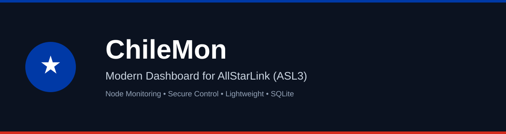
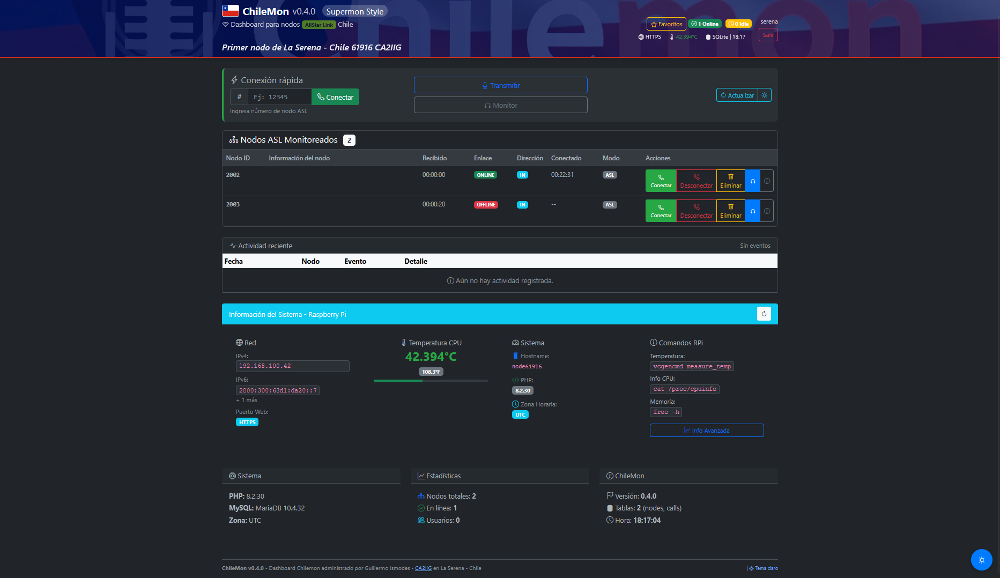
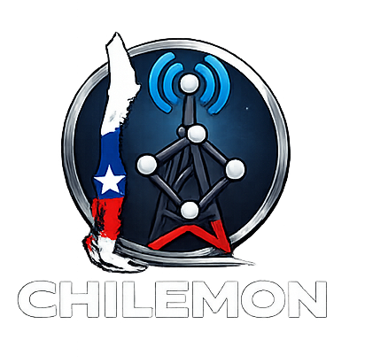
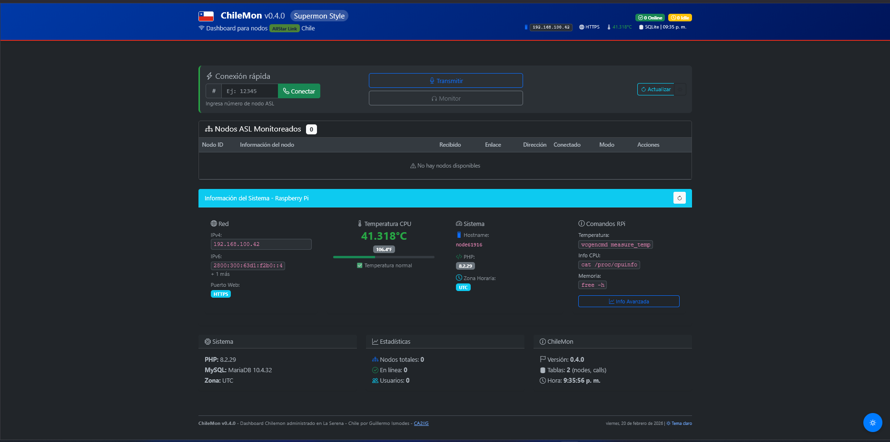
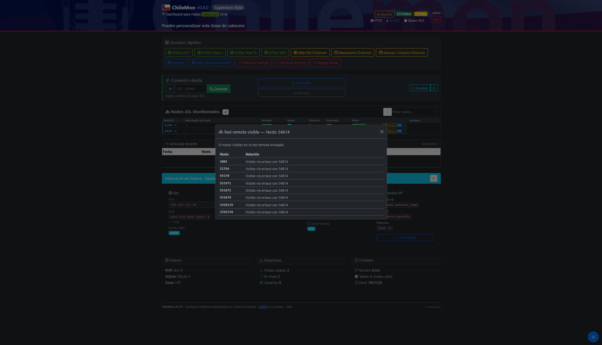
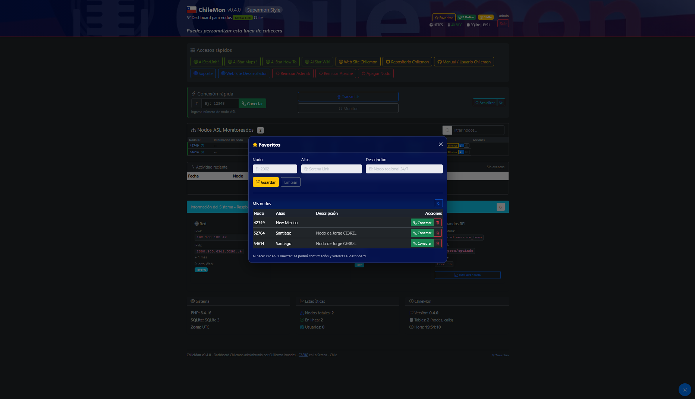

 <p align="center">
  
</p>

<p align="center">

</p>

##

<p align="center">
Modern dashboard for monitoring and controlling AllStarLink nodes
</p>

<p align="center">


</p>

# 
<p align="center">
  
</p>

Dashboard moderno para monitoreo y control de nodos **AllStarLink (ASL3)**. ChileMon nace como una alternativa moderna inspirada en **Supermon**, diseñada para ofrecer una interfaz más clara, modular y fácil de instalar para operadores de nodos AllStar.

El objetivo del proyecto es proporcionar una herramienta simple y segura para visualizar y controlar la actividad de un nodo AllStarLink desde un navegador web.


# 🌐 Idiomas

🇪🇸 Español: README_ES.md  
🇬🇧 English: README.md

---

# 📡 ¿Qué es ChileMon?

ChileMon es una aplicación web que permite:

- monitorear nodos conectados
- conectar nodos remotos
- desconectar nodos
- visualizar la red de nodos enlazados
- revisar estadísticas del nodo
- administrar nodos favoritos
- visualizar actividad reciente

Todo desde una interfaz web moderna.

---

# ✨ Características principales

ChileMon actualmente incluye:

- Dashboard web para monitoreo de nodos AllStarLink
- Conexión y desconexión de nodos remotos
- Visualización de nodos conectados en tiempo real
- Estadísticas del nodo obtenidas desde Asterisk
- Modal para visualizar la red de nodos enlazados
- Gestión de nodos favoritos
- Registro de actividad reciente
- Ejecución segura de comandos mediante wrapper
- Instalador automático para sistemas ASL3
- **Sistema de autenticación con roles** (admin/user)
- **Panel de administración** para gestión de usuarios e info del sistema
- **Health check endpoint** (`/api/health.php`)
- **Rate limiting** en todos los endpoints API
- **Node whitelist** para control de connect/disconnect
- **Protección CSRF** en todos los formularios
- **Puente de Audio WebRTC** — Push-to-Talk (PTT) desde el navegador
- **Inversión de Dirección IAX2** — Bridge como servidor IAX2 para compatibilidad ASL3
- **🗺️ Mapa de instalaciones** — Mapa comunitario opt-in que muestra todos los nodos ChileMon (Leaflet + OpenStreetMap)
- **Selector de mapa interactivo** — Clic para fijar coordenadas en el modal de registro con marcador arrastrable
- **Geocodificación de dirección** — Escribí una dirección y el mapa se posiciona automáticamente vía Nominatim (OpenStreetMap)
- **Registro cross-origin** — Los nodos agente se registran en el hub sin sesión previa

---

# 🧠 Filosofía del proyecto

ChileMon fue diseñado con los siguientes principios:

- **No interferir con AllStarLink**
- **No modificar Asterisk**
- **No reemplazar Supermon**
- **Ser una herramienta modular**
- **Ser fácil de instalar**
- **Ser seguro**

ChileMon funciona como un **módulo adicional**, sin alterar la instalación base del nodo.

---

# 🏗 Arquitectura

ChileMon está construido utilizando tecnologías simples y robustas.

### Backend

- PHP 8+
- SQLite

### Frontend

- Bootstrap 5
- JavaScript
- AJAX

### Servidor

- Apache

### Puente WebRTC

- Python 3.11+ (aiortc + aiohttp + websockets)
- WebSocket para audio en tiempo real
- Protocolo IAX2 para integración con Asterisk

---

# 🔐 Seguridad

ChileMon **no ejecuta comandos Asterisk directamente desde PHP**.

En su lugar utiliza un wrapper seguro:

```
/usr/local/bin/chilemon-rpt
```

Este wrapper permite ejecutar únicamente comandos específicos:

- rpt nodes
- rpt stats
- rpt connect
- rpt disconnect

Los comandos se ejecutan mediante una regla sudo restringida para el usuario:

```
www-data
```

Esto evita la ejecución arbitraria de comandos en el sistema.

### Características de seguridad adicionales

- **Roles de usuario**: Admin y usuario regular. Panel admin (`/admin.php`) restringido a administradores
- **Rate limiting**: Middleware reutilizable que limita los endpoints API para prevenir abuso
- **Protección CSRF**: Cada formulario incluye un token CSRF por sesión validado con comparación timing-safe
- **Session hardening**: Modo estricto, cookies HTTP-only, SameSite=Lax, timeout de inactividad
- **Node whitelist**: Restringir qué nodos pueden conectarse/desconectarse desde el dashboard
- **Health check**: Endpoint público para monitoreo (`/api/health.php`)
- **Sin credenciales hardcodeadas**: Todos los secretos vienen de entorno o `config/local.php`

---

# ⚙ Cómo funciona ChileMon

ChileMon obtiene información del nodo ejecutando comandos `rpt` de Asterisk.

Ejemplo:

```bash
sudo -u www-data sudo -n chilemon-rpt nodes 494780
```


El resultado es procesado por el servicio:

```
app/Services/AslRptService.php
```

Este servicio interpreta la salida de Asterisk y extrae información como:

- nodos conectados
- estado del nodo
- estadísticas del sistema

Los datos procesados son mostrados en el dashboard web.

---

# 🖥 Dashboard

El dashboard principal permite visualizar:

- nodo local
- nodos conectados
- estado del sistema
- red de nodos enlazados
- actividad reciente

Además permite:

- conectar nodos
- desconectar nodos
- administrar favoritos

---

# 🔎 ChileMon vs Supermon

Supermon es la interfaz clásica utilizada por muchos nodos AllStarLink.

ChileMon está inspirado en ese concepto, pero introduce una arquitectura más moderna.

| Característica | Supermon | ChileMon |
|---|---|---|
| Interfaz | HTML clásico | Dashboard moderno |
| Autenticación | Login básico | Sistema de usuarios |
| Base de datos | No | SQLite |
| Instalación | Manual | Instalador automático |
| Arquitectura | Monolítica | Modular |
| Extensibilidad | Limitada | Preparado para expansión |

ChileMon **no reemplaza Supermon**, sino que ofrece una alternativa moderna para monitoreo y control del nodo.

---

# 📷 Capturas de pantalla

### Dashboard



### Red de nodos



### Favoritos



---

# 🚀 Instalación

ChileMon se instala directamente en un nodo **ASL3**. Se recomienda un sistema basado en Debian (como la imagen oficial de ASL3).

### 📦 Instalación con un solo comando (Recomendada)

Copiá y pegá esta única línea en la Pi. Instala `git`, descarga el repositorio en `/opt/chilemon` y ejecuta el instalador:

```bash
curl -fsSL https://raw.githubusercontent.com/gismodes37/Chilemon/main/install/bootstrap.sh | sudo bash
```

Alternativa manual (solo si `git` ya está instalado):

```bash
sudo git clone https://github.com/gismodes37/Chilemon.git /opt/chilemon
cd /opt/chilemon && sudo bash install/install_chilemon.sh
```

El instalador ejecuta **14 pasos**:
1. Validar estructura del repositorio
2. Instalar dependencias base (git, Apache, PHP con SQLite/curl/mbstring, Python 3, sudo)
3. Pedir los datos del nodo (NUEVO) o leer la configuración existente (ACTUALIZACIÓN)
4. Preparar carpetas y permisos
5. Endurecer los permisos del repositorio para actualizaciones desde el dashboard
6. Generar la configuración local (NUEVO) o preservar la existente (ACTUALIZACIÓN)
7. Configurar módulos ASL3 de Asterisk
8. Configurar Asterisk para WebRTC (IAX2 + rpt.conf phonelogin)
9. Instalar el wrapper seguro y la regla sudoers
10. Configurar el alias de Apache
11. Habilitar el proxy WebSocket de Apache
12. Validar módulos PHP e inicializar la base de datos
13. **Instalar el puente WebRTC** (PTT desde el navegador — aiohttp, aiortc, websockets, servicio systemd)
14. Crear el usuario administrador (NUEVO) o ejecutar la verificación (ACTUALIZACIÓN)

> ⚠️ **Instalación NUEVA**: Ten a mano tu **número de nodo** ASL y la **clave AMI**. La clave AMI es el valor `secret=` del bloque `[admin]` en `/etc/asterisk/manager.conf`. El instalador ya detecta el host, puerto y usuario AMI, así que solo te pide la clave. También pregunta por la IP/host del servidor (ya prellenada), una descripción corta para tu nodo y una URL opcional del hub del mapa comunitario — presioná Enter para aceptar el valor por defecto u omitir.

> 💡 **ACTUALIZACIÓN (sistema existente)**: Si ya existe `config/local.php`, el instalador omite las preguntas, preserva tu configuración y solo agrega lo que falta.

> 🗺️ **Mapa de instalaciones (opcional)**: Durante una instalación NUEVA se te pregunta por una **URL de hub**. Si tenés una instancia ChileMon Hub, ingresá su URL (ej: `http://192.168.0.111`) para registrar el nodo en el mapa comunitario. Si no, presioná Enter.

> 🎯 **Puente de Audio WebRTC**: El puente para hablar por radio desde el navegador se instala automáticamente en el paso 13. Los secretos IAX2 y WebRTC los **genera el instalador** y los propaga a `config/local.php`, `iax.conf` y `/etc/default/chilemon-webrtc` — no hace falta editar esos archivos a mano.

Después de instalar, abrí `http://<ip-de-tu-pi>/chilemon` e ingresá con el usuario administrador creado en el paso 14.

### 🖥️ Companion de Windows (PTT desde el navegador)

1. En el dashboard, hacé clic en **Companion App** para descargar `chilemon-companion-install.bat`.
2. En la PC con Windows, hacé doble clic en ese archivo desde Descargas. Requiere Python 3.11+ e internet.
3. El instalador baja el código del companion desde GitHub, instala `numpy`, `sounddevice` y `aiohttp`, guarda la configuración generada en `%USERPROFILE%\.chilemon\config.toml`, registra el inicio automático y arranca el companion. La `host` generada es solo una pista: el Companion verifica el endpoint IAX2 alcanzable al arrancar y después de un cambio de IP.
4. El dashboard muestra **Companion Connected**. Presioná **Reconectar** para abrir la llamada IAX2.

Para desinstalar el companion por completo — para una prueba limpia o cambiar de PC — ejecutá `%USERPROFILE%\.chilemon\src\companion\uninstall-companion.bat`.

---

## ℹ️ ¿Qué rama uso?

`main` es la rama instalable. Los comandos de arriba siempre la usan, así que no hace falta elegir una rama o un tag manualmente.

---

## 🖥️ Opción 3: Máquina Virtual con Debian 13 + ASL3 + ChileMon

Para un sistema limpio y dedicado sin tocar tu instalación actual. Ideal para probar ChileMon en un entorno aislado o como servidor permanente.

#### 3.1 Crear la Máquina Virtual
- **VirtualBox**, **Proxmox VE**, o **VMware** — el que prefieras
- **SO invitado**: Debian 13 (Trixie) — descargar desde [debian.org](https://www.debian.org)
- **Mínimo**: 1 CPU, 1 GB RAM, 10 GB disco
- **Red**: Bridged o NAT con reenvío de puertos (80/443 para el dashboard, 4569 para IAX2, 5038 para AMI)

#### 3.2 Instalar Debian 13
Seguí la instalación estándar de Debian 13. Recomendado: solo entorno base (sin escritorio) para máxima compatibilidad con ASL3.

#### 3.3 Instalar ASL3
```bash
sudo apt-get update && sudo apt-get upgrade -y
sudo apt-get install -y wget
wget https://apt.allstarlink.org/repos/install
sudo bash install
```

#### 3.4 Instalar ChileMon
```bash
curl -fsSL https://raw.githubusercontent.com/gismodes37/Chilemon/main/install/bootstrap.sh | sudo bash
```
> El instalador detecta automáticamente modo NUEVO vs ACTUALIZACIÓN. En modo NUEVO pide el número de nodo y la clave AMI, y genera todos los secretos WebRTC.

#### 3.5 Acceder al Dashboard
Abrí `http://<ip-de-tu-vm>/chilemon` — PTT desde el navegador incluido 🇨🇱

---

# 📂 Estructura del proyecto

    chilemon/
      │
      ├── app/
      │   ├── Asterisk/         ← AslRptService, NodeTracker
      │   ├── Auth/             ← Auth (login, csrf, roles)
      │   ├── Controllers/      ← Dashboard, NodeApi
      │   ├── Core/             ← Database, RateLimiter
      │   ├── Services/         ← AslRptService (legacy compat), WebRTCBridge
      │   │   └── WebRTCBridge/ ← Python bridge (ami_client, iax2, audio, server)
      │   └── Views/            ← auth/login.view.php
      │
      ├── config/
      │   ├── app.php           ← Bootstrap + AMI + seguridad
      │   └── database.php
      │
      ├── data/
      │   └── chilemon.sqlite   (no versionar)
      │
      ├── logs/
      │
      ├── public/
      │   ├── index.php         ← Dashboard
      │   ├── login.php
      │   ├── logout.php
      │   ├── admin.php         ← Panel admin (usuarios + sistema)
      │   ├── api/
      │   │   ├── health.php    ← Health check endpoint
      │   │   ├── nodes.php
      │   │   ├── stats.php
      │   │   ├── connect.php
      │   │   ├── disconnect.php
      │   │   ├── delete_node.php
      │   │   ├── system_action.php
      │   │   ├── map/          ← Mapa comunitario de instalaciones
      │   │   │   ├── check.php
      │   │   │   ├── register.php
      │   │   │   └── data.php
      │   │   ├── favorites/    ← CRUD favoritos
      │   │   └── ami/          ← AMI status endpoints
      │   └── views/
      │       └── partials/     ← head, header, footer, scripts
      │
      ├── tests/                ← Pruebas PHPUnit
      ├── install/
      ├── bin/
      ├── phpunit.xml.dist
      ├── README.md
      ├── README_ES.md
      ├── CHANGELOG.md
      ├── LICENSE.md
      └── .gitignore


---

# 📈 Roadmap


**Release Actual** — Overhaul de seguridad, PTT Audio Bridge, inversión IAX2, rate limiting, CSRF, roles, panel admin, health check, mapa de instalaciones (hub + registro de agentes), selector de mapa interactivo con geocodificación de direcciones


**Siguiente** — Despliegue y pruebas en producción, TURN/STUN para PTT remoto, HTTPS/WSS, sesiones multiusuario, imagen production


**Release estable** — Listo para producción, documentación completa, probado por la comunidad

---

# 📦 Releases

## v0.4.0
- **Puente de Audio WebRTC**: Push-to-Talk (PTT) desde el navegador vía puente Python — audio WebRTC desde el dashboard a Asterisk IAX2
- **Inversión IAX2**: El bridge ahora actúa como servidor IAX2; Asterisk lo llama vía AMI Originate (corrige filtro callno=0 de ASL3)
- **Cliente AMI**: Nuevo cliente TCP asíncrono para Asterisk Manager Interface con reconexión y backoff exponencial
- **Soporte DTMF**: DTMF en llamada para keying/unkeying de nodos ASL (inmediato, no futuro)
- **Overhaul de seguridad**: Eliminación de credenciales hardcodeadas, local.php obligatorio, SRI en todos los CDN
- **Rate limiting**: Middleware RateLimiter aplicado a todos los endpoints API (12+ endpoints)
- **Roles de usuario**: Sistema admin/user con control de acceso en acciones sensibles
- **Protección CSRF**: Tokens por sesión con validación timing-safe en todos los formularios
- **Panel admin**: Nuevo `/admin.php` con gestión de usuarios (crear/eliminar/promover) e info del sistema
- **Health check**: Nuevo endpoint `/api/health.php` (30 req/min, modo degradado en fallo DB)
- **Node whitelist**: Lista configurable de nodos permitidos para connect/disconnect
- **Calidad**: `declare(strict_types=1)` en 13 archivos, require_once unificado a ROOT_PATH
- **PHPUnit scaffold**: `phpunit.xml.dist` + directorio tests con pruebas de Auth e infraestructura

## v0.3.1
- **Entorno Local (Docker)**: Soporte completo para desarrollo local mediante Docker Compose.
- **Mock de Comandos**: Script simulador para emular actividad RX/TX en entornos locales.

## v0.3.0
- **Integración total de Favoritos**: Visualización de estrellas y alias en el dashboard.
- **Botón de Toggle rápido**: Gestión directa de favoritos desde la tabla.
- **Instalador simplificado**: Nuevo proceso de instalación en un solo bloque.

## v0.2.x
- **Monitoreo en tiempo real**: Indicadores RX (verde) y TX (rojo) dinámicos.
- **Soporte EchoLink**: Identificación automática de conexiones EchoLink.
- **Wrapper v0.2.3**: Mejoras de seguridad y limpieza de parámetros.

## v0.1.0 (Legacy)

Primer release funcional de ChileMon.

Incluye:

- Dashboard operativo
- Conexión y desconexión de nodos
- Visualización de red de nodos
- Gestión de favoritos
- Actividad reciente
- Instalador automático
- Integración con AllStarLink

---

# ❤️ Apoyar ChileMon

ChileMon es un proyecto independiente desarrollado para la comunidad de radioaficionados y usuarios de **AllStarLink**. Si este proyecto te resulta útil, puedes apoyar su desarrollo con una **donación voluntaria**.

### ¿En qué ayudan las donaciones?

El desarrollo de ChileMon se realiza de forma independiente. Las donaciones ayudan a sostener el proyecto y permiten seguir mejorándolo.

- Desarrollo continuo del dashboard
- Pruebas en nodos reales AllStarLink
- Mejoras de seguridad y estabilidad
- Documentación y sitio web del proyecto
- Mantenimiento y evolución futura

### Formas de apoyar

- **PayPal:** [Apoyar Chilemon](https://www.paypal.com/ncp/payment/J56JZF5CPRBVG)
- **GitHub Sponsors:** [gismodes37](https://github.com/sponsors/gismodes37)

También puedes apoyar el proyecto colaborando con código, reportando errores o probando ChileMon en nodos reales.

> ChileMon es un proyecto comunitario para radioaficionados. Las donaciones son completamente voluntarias y ayudan a sostener el desarrollo del proyecto.

---


# 🤝 Contribuciones

Las contribuciones son bienvenidas.

Si deseas colaborar:

1. Haz un fork del repositorio
2. Crea una rama nueva
3. Envía un pull request

---

## 📄 Licencia

ChileMon se distribuye bajo licencia [MIT](LICENSE).


---

# 🇨🇱 ChileMon

Project developed for the Spanish-speaking AllStarLink community.


